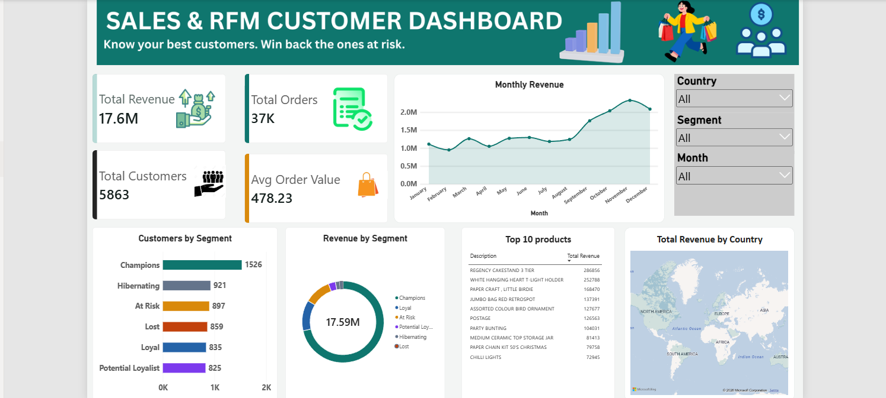

# Online Retail Sales & RFM Customer Segmentation

An end-to-end data analytics project using **PostgreSQL and Power BI** to analyze retail sales, identify business trends, and understand customer purchasing behaviour through RFM analysis.

## Tools Used
- **PostgreSQL (pgAdmin 4):** Data cleaning, data quality checks, and SQL analysis.
- **Power BI:** DAX measures, data visualization, and interactive dashboard.

## Project Overview
- Analyzed retail revenue, orders, and customer purchasing behaviour.
- Identified top-performing products and countries.
- Examined monthly revenue trends.
- Used RFM analysis to understand customer value and purchasing patterns.

## Dashboard Preview

## Key Dashboard Features
- Total Revenue, Total Orders, Total Customers, and Average Order Value.
- Monthly revenue trends.
- Top products and country-wise revenue.
- RFM customer segments.
- Interactive Country, Segment, and Month filters.

## Project Files
- `01_Create_Table.sql` — Table creation.
- `02_Data_Cleaning.sql` — Data quality checks and cleaning queries.
- `03_Business_Questions.sql` — SQL analysis queries.
- `Online_Retail_Sales_RFM_Dashboard.pbix` — Power BI dashboard.
- `dashboard_preview.png` — Dashboard screenshot.

## How to View
1. Obtain the required dataset separately.
2. Run the SQL scripts in PostgreSQL/pgAdmin.
3. Open the `.pbix` file using Power BI Desktop.

## Author
**Neelu** | Aspiring Data Analyst
